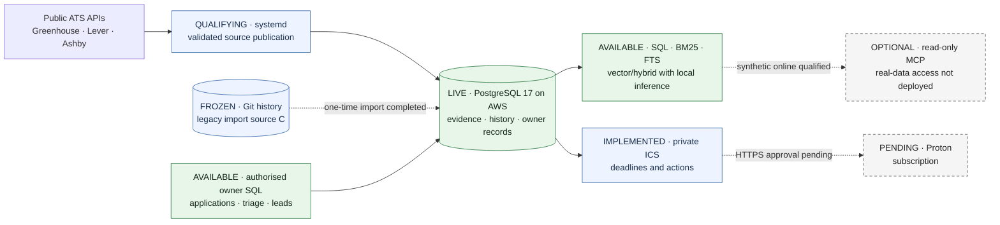

# Graduate Job Watch

Graduate Job Watch turns public recruitment feeds into a source-grounded record
of opportunities: what was observed, what changed and what remains uncertain.
Built for researching UK 2027 graduate roles in software, systems and applied AI,
it connects evidence-backed search with application triage and dated follow-ups.

**Status · 26 October 2026:** the real corpus is imported into AWS PostgreSQL and
independently restored/reconciled. Git collection is retired. Controlled collection
and final activation checks are in progress; routine SQL collection remains disabled
until they pass. [Production handover](docs/AWS_PRODUCTION_HANDOVER.md).

[Architecture](#how-it-works) · [Engineering decisions](#engineering-decisions) ·
[Example workflow](#a-synthetic-research-to-follow-up-workflow) ·
[Validation](#evidence-and-validation) · [Quickstart](#quickstart)

## At a glance

- **Reliable collection:** Greenhouse, Lever and Ashby ingestion with identity
  validation, source health and failure-safe retention.
- **Evidence and history:** stable posting keys, retained exclusions and immutable
  PostgreSQL versions distinguish new information from interpretation.
- **Composable research:** ordinary SQL, Python BM25, PostgreSQL full-text search
  and exact pgvector similarity, with optional hybrid ranking.
- **Scoped agent access:** five read-only MCP tools; separate, audited owner SQL.
  A real ChatGPT SQL call through a private tunnel passed against synthetic data.
- **Useful owner workflow:** applications, triage, evidenced leads, programme cycles
  and minimal deadline/action calendars share the same records.
- **Operational engineering:** Terraform, ARM64 EC2, protected encrypted storage,
  Systems Manager access, versioned S3 backups and tested independent restoration.

## How it works

PostgreSQL holds the imported and reconciled corpus on the existing AWS host.
Source publication is undergoing its controlled first scan before daily scheduling.
Frozen Git history is preserved as provenance; the dashed import edge is a completed
one-time migration, not ongoing synchronisation.



Coverage is bounded by configured feeds, not the graduate job market. The
25 October 2026 configuration enables **nine ATS boards**, alongside a wider employer
watchlist. Reports expose per-source freshness and failures; queue selection does
not define the research corpus.

## Engineering decisions

The PostgreSQL path makes the following trade-offs explicit.

**Separate evidence from judgment.** Provider wording, collector observations,
screening, independent checks and owner actions are distinct. Excluded postings
remain researchable. `not_seen` does not prove closure, feed presence does not
verify an open form, and screening is not a personal fit judgment.

**Publish atomically.** Runs register before fetching, with database-issued ordering.
A source lock serialises publication; retries/replays cannot duplicate history or
overwrite newer results. Postings, evidence and health commit together. Network
requests hold no locks. Multi-page Lever scans publish positives without inferring
absence; malformed feeds cannot masquerade as empty boards.
[Transaction and absence contract](docs/POSTGRESQL_COLLECTION.md#exact-transaction-and-absence-contract).

**Keep evidence immutable.** Versions retain complete parsed provider records as
hashed, NUL-safe bytes and track normaliser revisions. This preserves parsed values,
not original HTTP bytes. Comparison rules distinguish HTML formatting noise from
material metadata changes; legacy imports label missing native evidence honestly.
History timestamps describe collector observations, not asserted employer edit times.

**Use ordinary SQL with scoped authority.** Agents construct joins and aggregates
through psql/psycopg. Collector, owner, migrator, embedding worker and chat-read
roles have separate grants. Owner audit records the claimed actor and actual
database login, and rolls back with the transaction. MCP remains read-only.

**Treat retrieval as derived data.** BM25 preserves distinctions such as `C++`,
`C#` and `C` that English FTS tokenisation collapses. Semantic retrieval uses pinned,
text-only **EmbeddingGemma 2**, float32 and native **768-dimensional** vectors.
Exact cosine and optional reciprocal-rank fusion join back to retained versions.
Model/input/source hashes identify derivations; missing coverage is visible.
Inference stays local: it is not qualified for the 2 GiB database host.
SQL/BM25/FTS need no model.
[Retrieval implementation and limits](docs/POSTGRESQL_RETRIEVAL.md).

**Make recovery testable.** A frozen-Git importer recovers historical evidence and
reconciles each dataset. Terraform protects persistent EBS, backups and versioned
S3 state with native locking. SSM replaces public SSH/PostgreSQL access.
Hash/version-verified PostgreSQL archives have been restored into fresh targets,
including off-host. The owner-selected V1 policy uses twice-daily dumps to existing
versioned S3, 30-day current/noncurrent retention and CloudWatch/SNS email alerts.
Frequency is not a maximum RPO; missed runs, project lockout and regional failure
can cause greater loss. No external backup worker/provider is required.
[Backup policy and activation status](docs/AWS_BACKUP_POLICY.md).

## A synthetic research-to-follow-up workflow

Illustrative snippets for a **fresh disposable sandbox** containing synthetic
posting `greenhouse:test:1` and no application for it—not a live agent transcript.
See [sandbox setup](docs/POSTGRESQL_DEVELOPMENT.md) and the
[tested owner/calendar workflow](tests/postgres/test_owner_calendar.py).

**1. Research broadly and inspect freshness.** In a read-capable SQL session:

```sql
SELECT p.posting_key, p.title, p.verdict, p.status,
       p.last_seen_at, h.last_success_at, h.absence_safe
FROM jobwatch.research_postings p
JOIN jobwatch.source_health h ON h.source_id = p.source_id
ORDER BY p.last_seen_at DESC NULLS LAST, p.posting_key
LIMIT 5;
```

No verdict is filtered out. The optional lexical convenience is
`jobwatch-pg-ops search "Python" --method bm25`; vector/hybrid methods use the same
research path when the local model and derived rows are available.

**2. Inspect the retained source.** The existing read-tool request works through
the local JSON-lines harness or MCP, using the dedicated read identity:

```json
{"tool":"inspect_evidence","arguments":{"posting_key":"greenhouse:test:1","events_limit":5}}
```

The result includes provenance, normaliser identity, parsed evidence,
base64-encoded bytes with SHA-256, and material history. Source text is marked as
untrusted data.

**3. Record an authorised owner action.** Suppose the owner asks to bookmark this
synthetic role and review its requirements in one week. In a separate
`jobwatch_owner` SQL session, with psql `ON_ERROR_STOP` enabled:

```sql
BEGIN;
SET LOCAL jobwatch.actor = 'agent:synthetic-demo';
INSERT INTO jobwatch.applications
    (job_key, posting_key, company, role, url, stage, next_action, next_action_date)
SELECT 'manual:demo', posting_key, company, title, posting_url, 'bookmarked',
       'Review requirements', CURRENT_DATE + 7
FROM jobwatch.research_postings
WHERE posting_key = 'greenhouse:test:1';
COMMIT;

SELECT job_key, stage, next_action_date
FROM jobwatch.applications WHERE job_key = 'manual:demo';
```

The owner follow-up is not an employer deadline or application submission.
Audit attributes the change; collector evidence stays unchanged.
[SQL recipes](sql/postgresql/owner_workflows.sql) cover retries, stale guards,
explicit linking, rescheduling, clearing and rollback.

**4. Refresh the private calendar projection.** With the sandbox owner/read
connection configured:

```sh
jobwatch-pg-ops calendar snapshot \
  --output-dir .local-reports/calendar-demo --initialize
jobwatch-pg-ops calendar status --output-dir .local-reports/calendar-demo
```

Subsequent refreshes omit `--initialize`. `current/actions.ics` contains the dated
action, excluding notes, CV labels and free-form action text. Stable identities,
revision timestamps and atomic replacement prevent churn or partial publication.
Manual export is available; HTTPS/Proton subscriptions remain pending.
Subscription refresh is asynchronous, not guaranteed deadline alerting.

## Evidence and validation

Release-candidate checks, **25–26 October 2026**; hosted results remain dated
qualification evidence, not a fresh host inspection:

| Evidence | What it establishes |
|---|---|
| **258 offline tests** on each Python 3.11/3.12/3.13 | Provider/screening regressions, Riverlane URL spoofing/identity checks, file durability, privacy, calendar revisions, connection boundaries and backup-age/packaging checks. |
| **144 PostgreSQL tests**, including cached real-model inference | Actual migrations, constraints, grants, concurrent publication/rescreening, fail-closed publication, importer reconciliation, vector/hybrid queries, owner/audit workflows and local MCP interoperability. |
| **Hosted and independent synthetic recovery** | Real EC2-to-S3 backup, fresh-database restore, reboot/EBS persistence and ARM64-origin archive restoration into isolated local PostgreSQL 17, with row/security/sequence comparisons. |
| **Online ChatGPT synthetic connectivity** | An actual `sql_query` call traversed a private OpenAI tunnel to the restricted disposable database. Only this tool was exercised online; the remaining tools have local interoperability tests. |

[Connectivity test results](docs/AGENT_CONNECTIVITY_REPORT.md) ·
[Hosted qualification](docs/AWS_HOSTED_QUALIFICATION_REPORT.md) ·
[Independent recovery and its limits](docs/AWS_RECOVERY_READINESS_REPORT.md).

Provider regression fixtures include incident.io's formatting-only HTML changes
and a substantive Cambridge Consultants `Job Summary` update.

The real-model smoke test proves the implemented inference/retrieval path works;
it is not a relevance benchmark. Synthetic recovery does not establish
production-scale recovery time. Twice-daily AWS-only backup and health timers are
enabled after delivered email ALARM tests. An actual one-shot systemd timer invoked
the installed backup service, with verified S3 completion and independent restore.
The first ordinary midnight run remains unobserved; no strict maximum-loss
guarantee or external custody requirement is claimed. The online test proves synthetic connectivity, not hosted
production access or a live Proton integration.

## Status and roadmap

| Area | Status at this README's 26 October 2026 review |
|---|---|
| **Authoritative store** | AWS PostgreSQL, imported from frozen `9bbcb01` with complete reconciliation and independent real-data S3 restoration. Git observation files remain archived provenance; the old workflow is disabled and retired. |
| **PostgreSQL development** | Migrations 0001–0004, collection/history, importer, retrieval, owner SQL, calendar snapshots and read-only MCP locally qualified. |
| **Last qualified AWS deployment** | 26 October 2026: ARM64 `t4g.small`, PostgreSQL 17.11, pgvector 0.8.7 and migrations 0001–0004; native retrieval/recovery qualified. [Release `e3807a0`, including Riverlane fix, installed and natively tested](docs/AWS_RIVERLANE_MAINTENANCE_REPORT.md). [Installed-service/timer/S3/independent restore passed](docs/AWS_BACKUP_ACTIVATION_REPORT.md#installed-service-qualification--26-october-2001-utc); backup/health timers enabled, alarms OK and notification delivery previously confirmed. Intended domain tables empty; collection disabled. |
| **Activation in progress** | Owner GO and legacy acceptance recorded; nine real sources validated/activated. Controlled first collection and final scheduling checks remain. Real-data ChatGPT and Proton hosting remain separate follow-ons. |

The owner accepted the known unavailable historical evidence and the unpublished
26 October runner snapshot. Retained records are reconciled against the exact frozen
Git source. Current activation evidence and the authority boundary are recorded in
the [production handover](docs/AWS_PRODUCTION_HANDOVER.md).

ANN/rerankers and sophisticated autonomous actions are deferred.

## Quickstart

Python **3.11+**. Repository access is required: this is private source, not a
public release. For production SQL access, use the authenticated SSM/owner-peer
commands in the [handover](docs/AWS_PRODUCTION_HANDOVER.md#sql-first-operation).
For local development, these commands make no employer requests:

```sh
python3 -m venv .venv
.venv/bin/python -m pip install -e '.[postgres]'
.venv/bin/jobwatch-pg-ops --help
.venv/bin/python -m unittest discover -s tests -v

# Requires Docker; creates only its own disposable database:
PYTHON=.venv/bin/python bash scripts/test_postgres.sh
```

The old `jobwatch.cli` file-backed path is retained for frozen import/rehearsal
compatibility; it is not the production read/write interface.

The harness creates and removes its own verified disposable PostgreSQL 17/pgvector
container; it accepts no production database URL. Optional MCP and real-model tests
need their documented dependencies/cache and otherwise skip. Nothing installs a
hosted database, migrates production or starts collection automatically.

## Documentation

| Guide | Read it for |
|---|---|
| [Production handover](docs/AWS_PRODUCTION_HANDOVER.md) | Authority, SQL access, schedules and recovery |
| [Development and local PostgreSQL](docs/POSTGRESQL_DEVELOPMENT.md) | Installation, roles, migrations and disposable testing |
| [Collection and material history](docs/POSTGRESQL_COLLECTION.md) | Publication transactions, absence contracts and evidence comparison |
| [Operational research](docs/POSTGRESQL_OPERATIONS.md) | SQL views, search, reports, health and source activation |
| [Retrieval](docs/POSTGRESQL_RETRIEVAL.md) | Model/profile provenance, indexing, exact cosine and hybrid SQL |
| [Owner SQL workflows](docs/POSTGRESQL_OWNER_WORKFLOWS.md) | Authorised writes, audit, concurrency guards and read-back |
| [Agent connectivity](docs/AGENT_CONNECTIVITY.md) | Five-tool contract, synthetic online qualification and pending production access |
| [Proton calendar path](docs/PROTON_CALENDAR.md) | Minimal feeds, stable identities, privacy and subscription limits |
| [AWS-only backup policy](docs/AWS_BACKUP_POLICY.md) | Twice-daily schedule, retention, missing-run alerts, costs and restore procedure |
| [AWS infrastructure](infra/aws/README.md) | Terraform protections, SSM, deployment and backup/restore procedures |

This repository includes operational and private data. A recruiter-facing README
does not make the full repository safe to publish or change its visibility.
