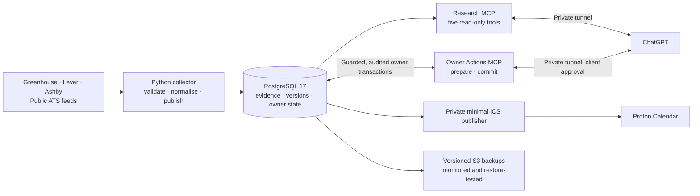

# Graduate Job Watch

Graduate Job Watch is a **small, self-hosted research and application-tracking system with a private ChatGPT interface**. It collects graduate vacancies from Greenhouse, Lever and Ashby into PostgreSQL, preserves the source evidence and change history, and supports research, decisions and follow-ups without treating an automated screening result as fact.

**Built with:** Python, PostgreSQL 17, SQL, two MCP services, AWS EC2, Terraform and systemd. ChatGPT provides an optional conversational interface; direct SQL and command-line workflows work independently. There is **no public web app**, and the system does not submit job applications.

**Operational snapshot — 27 October 2026:** nine monitored ATS feeds and scheduled collection on AWS; read-only ChatGPT research and separately permissioned owner actions; private calendar subscriptions; scheduled S3 backups, monitoring and restoration tests. This is a personal-scale system, not evidence of commercial scale or long-term uptime. [Dated production evidence](docs/V1_RELEASE_REPORT.md) · [Subsequent integration release](docs/INTEGRATION_RELEASE.md) · [Daily user guide](docs/USER_GUIDE.md).

[Workflow](#what-a-user-can-do) · [Architecture](#architecture-at-a-glance) · [Engineering decisions](#engineering-decisions) · [Synthetic example](#a-synthetic-research-to-follow-up-workflow) · [Validation](#evidence-and-validation) · [Development](#quickstart)

## What a user can do

1. **Research opportunities:** ask ChatGPT about vacancies or query PostgreSQL directly; search across records, including screened-out and historical evidence, with source freshness visible.
2. **Inspect evidence:** retrieve an exact posting, its preserved parsed provider representation, its revisions and the distinction between observed facts and inferred status.
3. **Record a decision:** request an application bookmark or triage update. The separate Owner Actions MCP service prepares a specific change for review; ChatGPT requests user confirmation before commit. Database restrictions, expected-state checks and audit protect the write independently of model instructions.
4. **Follow up:** view recorded application actions and dated deadlines in private calendar feeds.

The [worked synthetic example](#a-synthetic-research-to-follow-up-workflow) below shows the interfaces and data flow, **not yet a one-command seeded live demo**. The actual components are exercised by [read-tool tests](tests/postgres/test_read_tools.py) and [owner/calendar tests](tests/postgres/test_owner_calendar.py). No screenshots or AI outputs here are fabricated.

## Architecture at a glance



The two MCP servers use **different PostgreSQL roles and authority**: Research permits bounded reads; Owner Actions executes only reviewed application/triage/lead/follow-up recipes, not arbitrary SQL. Approval occurs in the ChatGPT client, while the server enforces the prepared values and current-state checks; a prepared token alone is not evidence of human approval. Access is private, not a public API. [Detailed agent authority](docs/AGENT_OWNER_TOOLS.md).

Collection, PostgreSQL, private integration services and scheduled operations run on AWS. Terraform protects infrastructure state and persistent storage; systemd schedules collection, backups, health checks and calendar publication. Model inference for optional vector retrieval is **not running on the production host**. [Infrastructure documentation](infra/aws/README.md).

**Scope:** nine monitored ATS feeds, not the entire graduate job market. A listing marked `not_seen` is not necessarily closed; appearing in a feed is not a verified open application form. Decisions about personal suitability are not inferred from collection.

## Engineering decisions

The PostgreSQL path makes the following trade-offs explicit.

**Separate evidence from judgment.** Provider wording, collector observations,
screening, independent checks and owner actions are distinct. Excluded postings
remain researchable. `not_seen` does not prove closure, feed presence does not
verify an open form, and screening is not a personal fit judgment.

**Publish atomically.** Runs register before fetching, with database-issued ordering.
A source lock serialises publication; retries/replays cannot duplicate history or
overwrite newer results. Postings, evidence and health commit together. Network
requests hold no locks. Multi-page Lever scans publish positives without inferring
absence; malformed feeds cannot masquerade as empty boards.
[Transaction and absence contract](docs/POSTGRESQL_COLLECTION.md#exact-transaction-and-absence-contract).

**Keep evidence immutable.** Versions retain complete parsed provider records as
hashed, NUL-safe bytes and track normaliser revisions. This preserves parsed values,
not original HTTP bytes. Comparison rules distinguish HTML formatting noise from
material metadata changes; legacy imports label missing native evidence honestly.
History timestamps describe collector observations, not asserted employer edit times.

**Use ordinary SQL with scoped authority.** Agents construct joins and aggregates
through psql/psycopg. Collector, owner, migrator, embedding worker and chat-read
roles have separate grants. Owner audit records the claimed actor and actual
database login, and rolls back with the transaction. The Research MCP is read-only. The separate Owner Actions MCP executes narrowly scoped, audited write recipes after the client presents a confirmation; the server binds the intended values and checks current state, but cannot independently prove the user approved.

**Treat retrieval as derived data.** BM25 preserves distinctions such as `C++`,
`C#` and `C` that English FTS tokenisation collapses. Semantic retrieval uses pinned,
text-only **EmbeddingGemma 2**, float32 and native **768-dimensional** vectors.
Exact cosine and optional reciprocal-rank fusion join back to retained versions.
Model/input/source hashes identify derivations; missing coverage is visible.
Inference stays local: it is not qualified for the 2 GiB database host.
SQL/BM25/FTS need no model.
[Retrieval implementation and limits](docs/POSTGRESQL_RETRIEVAL.md).

**Make recovery testable.** A frozen-Git importer recovers historical evidence and
reconciles each dataset. Terraform protects persistent EBS, backups and versioned
S3 state with native locking. SSM replaces public SSH/PostgreSQL access.
Hash/version-verified PostgreSQL archives have been restored into fresh targets,
including off-host. The owner-selected V1 policy uses twice-daily dumps to existing
versioned S3, 30-day current/noncurrent retention and CloudWatch/SNS email alerts.
Frequency is not a maximum RPO; missed runs, project lockout and regional failure
can cause greater loss. No external backup worker/provider is required.
[Backup policy and activation status](docs/AWS_BACKUP_POLICY.md).

## A synthetic research-to-follow-up workflow

**Illustrative interface example, not yet a runnable seeded demo.** The snippets below assume a disposable database containing synthetic posting `greenhouse:test:1`, with no existing application for that key. The [development sandbox instructions](docs/POSTGRESQL_DEVELOPMENT.md) create a blank database but do **not** seed this example automatically. Read and owner/calendar behaviour is independently exercised by [PostgreSQL integration tests](tests/postgres/); use their verified, disposable test harness to reproduce the individual contracts. A short, separately seeded demonstration remains a documentation follow-up, not an existing product feature.

**1. Research broadly and inspect freshness.** In a read-capable SQL session:

```sql
SELECT p.posting_key, p.title, p.verdict, p.status,
       p.last_seen_at, h.last_success_at, h.absence_safe
FROM jobwatch.research_postings p
JOIN jobwatch.source_health h ON h.source_id = p.source_id
ORDER BY p.last_seen_at DESC NULLS LAST, p.posting_key
LIMIT 5;
```

No verdict is filtered out. The optional lexical convenience is
`jobwatch-pg-ops search "Python" --method bm25`; vector/hybrid methods use the same
research path when the local model and derived rows are available.

**2. Inspect the retained source.** The existing read-tool request works through
the local JSON-lines harness or MCP, using the dedicated read identity:

```json
{"tool":"inspect_evidence","arguments":{"posting_key":"greenhouse:test:1","events_limit":5}}
```

The result includes provenance, normaliser identity, parsed evidence,
base64-encoded bytes with SHA-256, and material history. Source text is marked as
untrusted data.

**3. Record an authorised owner action.** Suppose the owner asks to bookmark this
synthetic role and review its requirements in one week. In a separate
`jobwatch_owner` SQL session, with psql `ON_ERROR_STOP` enabled:

```sql
BEGIN;
SET LOCAL jobwatch.actor = 'agent:synthetic-demo';
INSERT INTO jobwatch.applications
    (job_key, posting_key, company, role, url, stage, next_action, next_action_date)
SELECT 'manual:demo', posting_key, company, title, posting_url, 'bookmarked',
       'Review requirements', CURRENT_DATE + 7
FROM jobwatch.research_postings
WHERE posting_key = 'greenhouse:test:1';
COMMIT;

SELECT job_key, stage, next_action_date
FROM jobwatch.applications WHERE job_key = 'manual:demo';
```

The owner follow-up is not an employer deadline or application submission.
Audit attributes the change; collector evidence stays unchanged.
[SQL recipes](sql/postgresql/owner_workflows.sql) cover retries, stale guards,
explicit linking, rescheduling, clearing and rollback.

**4. Refresh the private calendar projection.** With the sandbox owner/read
connection configured:

```sh
jobwatch-pg-ops calendar snapshot \
  --output-dir .local-reports/calendar-demo --initialize
jobwatch-pg-ops calendar status --output-dir .local-reports/calendar-demo
```

Subsequent refreshes omit `--initialize`. `current/actions.ics` contains the dated
action, excluding notes, CV labels and free-form action text. Stable identities,
revision timestamps and atomic replacement prevent churn or partial publication.
Manual export remains available; hourly private HTTPS feeds are live for Proton.
Subscription refresh is asynchronous, not guaranteed deadline alerting.

## Evidence and validation

**Dated executions, not a claim that the GitHub CI runs the full matrix.**

| Evidence | What it establishes |
|---|---|
| **V1 release, 27 October:** 258 offline tests per Python 3.11/3.12/3.13, plus 147 PostgreSQL tests | Release-qualified collector, evidence, permissions, migration, retrieval, audit, calendar and recovery contracts. [V1 report](docs/V1_RELEASE_REPORT.md). |
| **Agent/calendar integration qualification, 27 October:** 264 offline and 158 PostgreSQL tests on the documented environment | Later integration feature and disposable database qualification, including restricted write flows. [Qualification report](docs/AGENT_CALENDAR_INTEGRATION_REPORT.md). |
| **Actual scheduled AWS operation, 27 October** | First unattended collection published nine feeds with 620 positive observations; the midnight backup was verified in S3. This demonstrates initial operation, not sustained uptime or scale. |
| **Independent-target restoration** | Actual S3 archives were restored into fresh, isolated PostgreSQL targets and reconciled for data, permissions and sequences. It is not a third-party audit or a fixed recovery-time guarantee. |
| **Private ChatGPT/Proton integration closeout, 27 October** | Research tools and confirmed owner-action path were checked; owner reported calendar subscription and alert delivery. The live personal integrations are not a public demo. [Integration report](docs/INTEGRATION_RELEASE.md). |

GitHub Actions currently runs the **base offline suite on Python 3.12** plus data validation; it does **not** reproduce the full PostgreSQL, model-enabled or multi-interpreter qualification. Some regression fixtures are reduced captured **public** ATS responses, supplemented with synthetic inputs; no applicant records should be used for demonstration. [Fixture provenance](tests/fixtures/README.md).

[Connectivity test results](docs/AGENT_CONNECTIVITY_REPORT.md) ·
[Hosted qualification](docs/AWS_HOSTED_QUALIFICATION_REPORT.md) ·
[Independent recovery and its limits](docs/AWS_RECOVERY_READINESS_REPORT.md).

Provider regression fixtures include incident.io's formatting-only HTML changes
and a substantive Cambridge Consultants `Job Summary` update.

The real-model smoke test qualifies inference/retrieval, not matching accuracy.
Independent restores prove recoverability of the tested archives, not a fixed RTO.
Backups run at 00:00/12:00 UTC with fifteen-minute health checks and previously
delivered failure/stale/missing-heartbeat email tests. This AWS-only policy has
no strict twelve-hour maximum-loss guarantee or independent cloud custody.
Production embeddings are not active. ChatGPT real-data access and Proton feeds
are live; see the [integration release](docs/INTEGRATION_RELEASE.md).

## Status and roadmap

| Area | Status verified 27 October 2026 |
|---|---|
| **Authoritative store** | AWS PostgreSQL, imported from frozen `9bbcb01` with complete reconciliation and independent real-data S3 restoration. Git observation files remain archived provenance; the old workflow is disabled and retired. |
| **PostgreSQL development** | Migrations 0001–0004, collection/history, importer, retrieval and local MCP qualification. The Research MCP is read-only; Owner Actions has separately constrained writes. |
| **Database deployment baseline** | The 26 October V1 database installation was qualified as `e3807a0` with PostgreSQL 17.11 / pgvector 0.8.7 and tested restoration. The **later** ChatGPT/calendar integration release deployed code `41f640b` on 27 October with documented host-only adjustments. See the [integration release](docs/INTEGRATION_RELEASE.md) for exact scope and remaining limitations. |
| **Production operation** | First unattended run: nine feeds, 620 positives; 636 retained postings including 579 exclusions as of 27 October. History and owner state preserved. Collection daily at 06:15 UTC + up to five minutes; backups at 00:00/12:00 UTC; health every fifteen minutes. |
| **Integrations** | Live 27 October: private Proton feeds (hourly, revocable) and two ChatGPT apps over private tunnels; every owner write needs ChatGPT approval. [Integration release](docs/INTEGRATION_RELEASE.md). |
| **Optional follow-ons** | Production vector population/inference. Core SQL research and owner workflows do not depend on the integrations. |

The owner accepted the known unavailable historical evidence and the unpublished
26 October runner snapshot. Retained records are reconciled against the exact frozen
Git source. Current operating evidence and the authority boundary are recorded in
the [production handover](docs/AWS_PRODUCTION_HANDOVER.md).

ANN/rerankers and sophisticated autonomous actions are deferred.

## Quickstart

Python **3.11+**. Repository access is required: this is private source, not a
public release. For daily reports, searches and application tracking, follow the
short [user guide](docs/USER_GUIDE.md). It uses authenticated SSM and restricted
owner SQL; there is no public database or web application.
For local development, these commands make no employer requests:

```sh
python3 -m venv .venv
.venv/bin/python -m pip install -e '.[postgres]'
.venv/bin/jobwatch-pg-ops --help
.venv/bin/python -m unittest discover -s tests -v

# Requires Docker; creates only its own disposable database:
PYTHON=.venv/bin/python bash scripts/test_postgres.sh
```

The old `jobwatch.cli` file-backed path is retained for frozen import/rehearsal
compatibility; it is not the production read/write interface.

The harness creates and removes its own verified disposable PostgreSQL 17/pgvector
container; it accepts no production database URL. Optional MCP and real-model tests
need their documented dependencies/cache and otherwise skip. Nothing installs a
hosted database, migrates production or starts collection automatically.

## Documentation

| Guide | Read it for |
|---|---|
| [User guide](docs/USER_GUIDE.md) | Connect, report, research, shortlist and track applications |
| [V1 release report](docs/V1_RELEASE_REPORT.md) | Actual unattended operation, release scope and limitations |
| [Production handover](docs/AWS_PRODUCTION_HANDOVER.md) | Authority, SQL access, schedules and recovery |
| [Development and local PostgreSQL](docs/POSTGRESQL_DEVELOPMENT.md) | Installation, roles, migrations and disposable testing |
| [Collection and material history](docs/POSTGRESQL_COLLECTION.md) | Publication transactions, absence contracts and evidence comparison |
| [Operational research](docs/POSTGRESQL_OPERATIONS.md) | SQL views, search, reports, health and source activation |
| [Retrieval](docs/POSTGRESQL_RETRIEVAL.md) | Model/profile provenance, indexing, exact cosine and hybrid SQL |
| [Owner SQL workflows](docs/POSTGRESQL_OWNER_WORKFLOWS.md) | Authorised writes, audit, concurrency guards and read-back |
| [Integration release](docs/INTEGRATION_RELEASE.md) | Deployed identifiers, closeout health and owner-side checks |
| [Agent connectivity](docs/AGENT_CONNECTIVITY.md) | Five-tool contract and online qualification history |
| [Optional agent owner tools](docs/AGENT_OWNER_TOOLS.md) | Existing SQL recipes over a separate confirmed-write connection ([approved scope](docs/AGENT_CALENDAR_APPROVAL.md)) |
| [Proton calendar path](docs/PROTON_CALENDAR.md) | Minimal feeds, stable identities, privacy and subscription limits |
| [AWS-only backup policy](docs/AWS_BACKUP_POLICY.md) | Twice-daily schedule, retention, missing-run alerts, costs and restore procedure |
| [AWS infrastructure](infra/aws/README.md) | Terraform protections, SSM, deployment and backup/restore procedures |

This repository includes operational and private data. A recruiter-facing README
does not make the full repository safe to publish or change its visibility.
