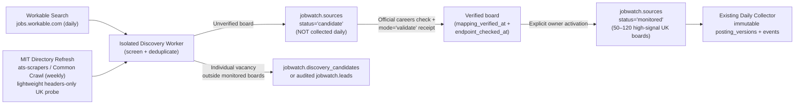

# Graduate Job Watch — Automated ATS-Wide Discovery Feasibility Report

**Date:** 24 November 2026 (UTC)  
**Repository baseline:** `main` at `1f0d792` (packaged release `f3d18cd` running on AWS EC2 `t4g.small`, `eu-north-1`)  
**Scope:** Read-only feasibility investigation and isolated bounded experiments across **Workable** (prioritised first), **Greenhouse**, **Ashby**, and **Lever**. No production writes, schema migrations, schedule edits, employer activations, or infrastructure changes were performed.

---

## Executive summary

1. **Workable provider-wide discovery works today without employer seeding.** Workable operates an unauthenticated cross-employer search endpoint (`https://jobs.workable.com/api/v1/jobs`, reporting `9,825` UK postings on 24 November 2026) paired with per-employer public widget feeds (`https://apply.workable.com/api/v1/widget/accounts/{slug}?details=true`).
2. **Held-out acceptance test passed (`workable:stalis:1C9CCEA6B4`).** An unseeded 10-query UK graduate/early-career Workable discovery run (`17` search requests, `2.39 MiB`, `0` rate limits) independently retrieved **150 unique UK vacancies across 81 previously unknown employers** (`0%` overlap with the 44 registered production employers), including **51 relevant candidates (`7 priority`, `44 review`)**. Stalis's *Data Science & AI Graduate* posting ranked **#1** across four independent generic queries and resolved via the public widget API to canonical identity **`workable:stalis:1C9CCEA6B4`**.
3. **End-to-end entry into Graduate Job Watch was verified in an isolated disposable PostgreSQL 17 container** via both **Path A** (zero schema migration today via audited `jobwatch.leads`) and **Path B** (native ATS evidence persistence into `sources` → `collection_runs` → `postings` → immutable `posting_versions` → `posting_events` → unchanged `research.search` BM25/FTS and `research.evidence`).
4. **Greenhouse, Ashby, and Lever have no public provider-wide search API or official employer directory.** Discovery for those three providers must rely on open-source/Common Crawl directories (`kalil0321/ats-scrapers` MIT achieved **9/9 = 100%** recall of our current monitored production boards and **93–100%** active rates on Greenhouse/Ashby) combined with vacancy-first discovery.
5. **Immediate hidden coverage inside our own manual watchlist.** Cross-checking public directories against the 35 unmonitored `provider='manual'` employers already in `config/employers.json` identified **11 active public ATS boards** (`1,841` live postings) yielding **160 relevant candidates (`10 priority`, `150 review`)** — including **10 `priority` 2027 UK Graduate roles at Graphcore alone** — while also proving why unverified slug matching is dangerous (`greenhouse:wise` belongs to US-based Wise Foods, not UK fintech Wise PLC).
6. **Selective/hybrid discovery is mandatory on the 2 GiB EC2 host.** Extrapolating from live production baselines (`638` listed postings / `2,107` versions / `67.8 MiB` DB / `155–172 MiB` BM25 history peak against `MemoryMax=256M` and the `10,000`-row `working_set_too_large` guard) shows that blindly monitoring `250+` boards breaks in-Python BM25 and `ReadTools.working_set`, while `5,000` boards overflows the 16 GiB EBS volume within weeks. **Hybrid Approach D** — bounded provider-wide search (Workable) + decoupled periodic UK-targeted directory discovery + selective monitoring of **50–120 high-signal verified UK boards** — delivers an order-of-magnitude increase in relevant UK graduate coverage without resizing the `t4g.small` host.

---

## 1. Existing capability audit

### 1.1 Live production baseline (read-only query, 24 November 2026)

Captured via read-only SQL (`default_transaction_read_only=on`) over SSM against `i-0a21a9da641e3f22e` (`t4g.small`, ARM64, `1,834 MiB` RAM, `0` swap, `16 GiB` gp3 EBS for PostgreSQL):

| Metric | Measured live value (2026-11-24T20:36:05Z) | Notes |
| --- | ---: | --- |
| Registered employers (`jobwatch.employers`) | **44** | 9 with active ATS sources; 35 manual-watch entries |
| Registered / monitored ATS sources (`jobwatch.sources`) | **9 / 9** | 4 Greenhouse (2 EU, 2 global), 3 Ashby, 2 Lever; **0 Workable** |
| Retained postings (`postings`: listed / `not_seen`) | **778** (`638` / `140`) | Listed verdicts: **6 `priority`**, **47 `review`**, **585 `excluded`** |
| Immutable evidence versions (`posting_versions`) | **2,107** | Mean `evidence` `19,335 B`; mean `description_text` `8,917 B` |
| Material/observation/screening events (`posting_events`) | **1,276** | Plus `375` `collection_runs`, `41` `leads`, `24` `verifications` |
| PostgreSQL database size | **67.8 MiB** (`71,079,603 B`) | `posting_versions` = `54.3 MiB` (`80.1%` of DB); EBS `206 MiB / 16 GiB` (`2%`) |
| Latest S3 compressed backup (`2026-11-24T12:00:24Z`) | **16.1 MiB** (`16,906,241 B`) | Up from `12.4 MiB` (`13,033,724 B`) at 26 Oct cutover |
| Daily collection duration (all 9 sources, 24 Nov 06:15Z) | **22.4 s** | Palantir (`306` jobs, 4 pages) = `14.2 s`; other 8 boards = `0.10–2.45 s` each |
| Host RAM utilisation | `642 MiB` used / `1,192 MiB` avail | `jobwatch-agent-read` capped at `MemoryMax=256M`, `CPUQuota=25%` |

### 1.2 What automated discovery exists — and what was previously built or deferred

Inspecting the repository, Git history, `docs/DISCOVERY_DESIGN_NOTE.md`, `docs/DISCOVERY_ARCHITECTURE_REVIEW.md`, `docs/PHASE_REPORT.md`, `docs/P0_AUDIT.md`, `docs/ATS_SOURCE_VALIDATION_REPORT.md`, and `docs/MCP_RELIABILITY_REPAIR.md` establishes:

- **Zero automated external employer or cross-ATS discovery exists today.** The 22–23 October 2026 *"Discovery Index Sprint"* (`DISCOVERY_ARCHITECTURE_REVIEW.md`) solved **within-board recall** (storing every posting on already-monitored boards, including excluded roles, separating source events from screening events, and replacing title-only dropping with structured reason codes). It did **not** implement external employer or cross-ATS discovery.
- **Workable ingestion was explicitly deferred.** `docs/MCP_RELIABILITY_REPAIR.md` (§"Separate coverage item (not implemented)") records that Workable ingestion does not exist in `feeds.py`, `config/`, or PostgreSQL constraints, and was left for a separate discussion.
- **How the 44 employers, 9 monitored boards, and 41 leads were originally discovered:**
  1. **Initial starter (3 boards):** Palantir (Lever), Monzo (Greenhouse), and incident.io (Ashby) came from the original scaffold and were verified manually against official careers pages during P0 (`17 October 2026`, `docs/P0_AUDIT.md`).
  2. **P1 manual watchlist expansion (to 31, then 44 employers):** Added manually during P1 (`17 October 2026`, `docs/PHASE_REPORT.md` and `config/employers.json`) via manual web research of official UK employer careers pages. Six additional boards (Scott Logic, Cambridge Consultants, Riverlane, Marshall Wace, hyperexponential, Tracebit) were manually mapping-verified against employer HTML/JS (`commit b24f4d4`, revalidated `26 October 2026` in `docs/ATS_SOURCE_VALIDATION_REPORT.md`).
  3. **Rejected / unverified ATS candidates already recorded in `config/employers.json`:** `Healf` (Ashby, 0 junior roles), `DV Trading` (Greenhouse `dvtrading`, origin TLS HTTP 526 blocked official-site verification), `Fifty One Degrees (51D)`, `Resonance (Applied AI)`, `Bloxd` (Ashby boards discovered via third-party listings whose employer websites could not be verified), plus `Roke` (403), `AND Digital`, and `Raspberry Pi` (404) omitted during P1.
  4. **External leads (34 at cutover → 41 today):** Manually researched and recorded via audited SQL / Owner Actions (`jobwatch.leads`), never populated by an automated crawler.

### 1.3 Reusable components vs required extensions

| Existing component | Reusable unmodified? | Exact boundary / extension needed for ATS-wide discovery |
| --- | --- | --- |
| `jobwatch.filtering.screen()` (`screen-2026-10-23.1`) | **Yes** | Accepts any dict with `title`, `location`, `country`, `countries`, `department`, `team`, `employment_type`, `description`; immediately works on Workable search/widget records and directory boards. |
| `jobwatch.postgres.evidence.encode_evidence()` | **Yes** | Deterministic ASCII JSON bytes + PostgreSQL `sha256(evidence)` works for any provider JSON object. |
| `jobwatch.postgres.collection.normalize_v1()` / `Processing` / `timing.deadline_evidence()` | **Yes** (for any `feeds.Posting`) | Only `REQUESTS` dict and `absence_safe` branch need a `'workable'` entry; `replay_native` needs a `'workable'` branch. |
| `jobwatch.postgres.publisher.Collector` & `endpoints.check_endpoint` / `activate_source` | **Yes** | Source-first locking, `status='candidate'` vs `'monitored'`, and `mode='validate'` receipts already separate discovery from verification and monitoring. |
| `jobwatch.postgres.research` (views, FTS, BM25, `evidence`, `deadlines`) | **Yes** (within scale bounds) | Unchanged views and search immediately index Workable postings; BM25 memory/timeout limits bind corpus scaling (§8). |
| `jobwatch.leads` table & `record_lead` owner recipe | **Yes (zero migration)** | Already stores external `kind='vacancy'` leads with `official`, `source_note`, `url_exact`, `posting_key` FK, and `owner_audit`. |
| `jobwatch.sources` table (`0001_initial.sql`) | **Small migration needed** | Currently constrains `provider IN ('greenhouse','lever','ashby')` and `board ~ '^[A-Za-z0-9_-]+$'` (rejects Workable and dotted Ashby slugs such as `iwoca.co.uk`). Already has `status='candidate'`, `discovered_by`, `discovered_at`, `mapping_verified_*`, and `endpoint_checked_at`. |
| `jobwatch.feeds` (`_link`, `BOARD`, `collect_board`) | **Small extension needed** | Needs Workable widget adapter (with multi-location shortcode grouping), dotted/case-insensitive Ashby board validation, and a structured per-source custom-host policy for Greenhouse boards using employer-hosted `?gh_jid=` URLs (currently hardcoded only for `riverlane`). |
| `jobwatch.identity.POSTING_KEY` | **1-line regex update** | Currently `r'(?:greenhouse|lever|ashby):...'` — needs `workable` added. |
| `jobwatch.postgres.material.material()` | **1 provider branch** | Needs `'workable'` material field comparison rules alongside `greenhouse`, `lever`, and `ashby`. |

---

## 2. Provider-by-provider discovery findings

All `robots.txt`, sitemap, and public endpoint behaviours below were **directly tested live on 24 November 2026** (no private endpoints reverse-engineered, no access controls bypassed).

| Dimension | Workable | Greenhouse | Ashby | Lever |
| --- | --- | --- | --- | --- |
| **Provider-wide vacancy search?** | **Yes (unauthenticated, undocumented frontend API)**: `GET https://jobs.workable.com/api/v1/jobs` | **No.** `my.greenhouse.io` is an authenticated candidate portal; `/sitemap.xml` returns HTTP 500. | **No.** | **No.** |
| **Official employer directory or sitemap?** | **Partial sitemap**: `jobs.workable.com/sitemap.xml` lists search landing pages (not company slugs); `apply.workable.com/sitemap.xml` returns an SPA shell. | **No.** `boards.greenhouse.io/sitemap.xml` & `job-boards.greenhouse.io/sitemap.xml` return HTTP 404. | **No.** `jobs.ashbyhq.com/sitemap.xml` returns HTTP 404. | **No.** `jobs.lever.co/sitemap.xml` returns HTTP 404. |
| **Per-employer public board API** | **Public widget API (unauthenticated)**: `GET https://apply.workable.com/api/v1/widget/accounts/{slug}?details=true` (official authenticated ATS API is `spi/v3/jobs`, Bearer token required). | **Documented public Job Board API**: `GET https://boards-api.greenhouse.io/v1/boards/{token}/jobs?content=true` | **Documented public Posting API v1**: `GET https://api.ashbyhq.com/posting-api/job-board/{slug}?includeCompensation=true` | **Documented public Postings API v0**: `GET https://api.[eu.]lever.co/v0/postings/{slug}?mode=json&skip=N&limit=100` |
| **Pre-fetch filtering by location/title/date?** | **Yes** on `jobs.workable.com/api/v1/jobs` (`query`, `location`, `workplace`, `day_range`, cursor `pageToken`). No server-side filter on widget endpoint. | **No** cross-board search. Per-board supports `content=false` (lightweight title/location/date headers) before fetching full descriptions. | **No** cross-board or server-side location/date filter; single JSON returns full board. | **No** cross-board search. Per-board supports query params (`location`, `team`, `commitment`, `skip`, `limit`) on a known board. |
| **`robots.txt` & content signals** | `jobs.workable.com`: `Content-Signal: search=yes, ai-input=yes, ai-train=no`; disallows `/search*?*` (HTML), allows `/search/*`; does **not** disallow `/api/`. `apply.workable.com`: `Disallow:` (open), same `Content-Signal`. | `boards-api.greenhouse.io`: `Disallow: /embed/`. `job-boards.greenhouse.io`: open. `my.greenhouse.io`: `Allow: /`. | `jobs.ashbyhq.com`: `Disallow: /meeting/, /b/, /api/`. `api.ashbyhq.com/robots.txt`: HTTP 401 (documented public posting API is unauthenticated). | `api.lever.co`: `Allow: /`, **`Crawl-delay: 1`**. `jobs.lever.co`: `Content-Signal` header policy. |
| **Rate limits & WAF** | `jobs.workable.com/api/v1/jobs`: Cloudflare-fronted; **0 errors in 17 requests at 0.5 s delay**. `apply.workable.com`: Cloudflare-fronted; published community measurements report HTTP 429 / CF 1015 around ~8 req/40 s on rapid bursts; **0 429s in 35 requests at 1.5 s delay**. | No published GET quota; `0` errors across `33` live requests at `0.4 s` delay. | No published GET quota; `0` errors across `18` live requests at `0.4 s` delay. | `Crawl-delay: 1` respected; `0` errors across `15` live requests at `0.4 s` delay (use `>=1.0 s` in production per `feeds.py`). |
| **Completeness & freshness** | `jobs.workable.com` is **very fresh** (retrieved Stalis role created `2026-11-23T15:53Z` within <29h) and reports `9,825` UK postings, **but** is opt-in to Workable's job board and mixes a small fraction of non-Workable partner listings (`organizations: ['lgbt']` observed on Station). Widget API is authoritative per account. | Per-board API is authoritative and complete (`meta.total` enables absence-safe collection). EU boards (`job-boards.eu.greenhouse.io`) use the same `boards-api.greenhouse.io` endpoint; custom employer `?gh_jid=` URLs are common (`Jane Street`, `Ocado`, `Stripe`). | Per-board API is authoritative (`apiVersion='1'` single response, absence-safe). Watch for **mixed-case slugs** (`Snyk`) and **dotted slugs** (`iwoca.co.uk`). | Per-board API is authoritative, offset-paginated (multi-page runs are positive-only under existing contract); EU accounts require `api.eu.lever.co`. |
| **Terms & data-use boundary** | Workable general ToS prohibits bulk harvesting/misuse or candidate PII collection. Personal, read-only, rate-limited discovery of public vacancy metadata avoids PII and application endpoints, but `jobs.workable.com/api/v1/jobs` is **undocumented** (higher breakage risk than documented APIs) and should be treated as a discovery feeder rather than an authoritative evidence source. | Customer SaaS terms; public Job Board API is explicitly documented for read-only job listing retrieval. | Customer SaaS terms; Public Job Posting API is explicitly documented for public read-only consumption. | Customer SaaS terms; Postings API v0 is explicitly documented for public read-only consumption. |

### 2.1 Critical Workable technical quirks discovered live

1. **Multi-location duplicate `shortcode` expansion in the widget API:** `https://apply.workable.com/api/v1/widget/accounts/stalis?details=true` returned `4` array entries for `2` unique vacancies — emitting **`1C9CCEA6B4` twice** (once for `country: "Ireland"` / `IE` and once for `country: "United Kingdom"` / `GB`), with identical title, description, URL, and dates. Any Workable collector adapter **must group/merge widget entries by `shortcode`** before enforcing unique posting identity, preserving all location entries in evidence.
2. **Multi-location search UUID fan-out:** On `jobs.workable.com/api/v1/jobs`, a single Workable vacancy can appear as multiple location-specific search UUIDs (e.g., Hamiltonian Dynamics published three separate search UUIDs on `2026-11-17` for *Software Engineer* across London, Manchester, and Gloucestershire that all resolved to one canonical widget posting `workable:hamiltonian-dynamics:FC4A48D11F`). Deduplication must therefore use `workable:{account}:{shortcode}` once resolved.
3. **Non-Workable partner/syndicated employers on `jobs.workable.com`:** `jobs.workable.com/api/v1/companies/{id}` returns an `organizations` array (e.g. `['workable']` vs `['lgbt']`) and some large employers (e.g. Man Group, Neuberger Berman, Nomura, Zoopla) appear on `jobs.workable.com` without an open `apply.workable.com` widget board (`HTTP 404`). Resolution must therefore require **strict company-name + posting-title corroboration** against the widget API, never blind slug guessing.

---

## 3. External dataset and directory assessment

Five public datasets/directories and two community new-grad repositories were inspected on **24 November 2026** and validated live against official ATS endpoints.

### 3.1 Dataset inventory, licensing, and overlap

| Dataset / Source | License | Last updated (observed) | Greenhouse | Lever | Ashby | Workable | Recall of our 9 monitored prod boards | Suitability |
| --- | --- | --- | ---: | ---: | ---: | ---: | :---: | --- |
| **`kalil0321/ats-scrapers`** (`ats-companies/*.csv`) | **MIT** | `2026-11-24` (daily) | 7,363 | 2,377 | 4,171 | 4,755 | **9 / 9 (100%)** | **Best overall** for bootstrapping + periodic refresh (includes EU Greenhouse boards `riverlane` & `cambridgeconsultantslimited`) |
| **`elliottdehn/open-jobs`** (`slugs.json`) | **CC0-1.0** | `2026-09-09` (`pushed 2026-10-11`) | 5,470 | 2,203 | 2,908 | 6,818 | 7 / 9 (missed EU GH boards) | Good secondary bootstrap (largest Workable slug list, explicit `gone` tombstones) |
| **`feashliaa/job-board-aggregator`** (`data/*_companies.json`) | **MIT** | `2026-11-24` (daily) | 8,333 | 4,368 | 3,161 | — | 7 / 9 (missed EU GH boards) | Higher dead-board noise (`40%` 404 on GH/Lever); secondary union only |
| **HuggingFace `latmay/ats-career-page-urls`** | **CC BY 4.0** | `2026-11-05` | 10K–100K total multi-ATS rows | (upstream seed for `ats-scrapers`) | — | — | Indirectly included in `ats-scrapers` | Upstream seed; `ats-scrapers` already filters it to live boards |
| **Common Crawl CDX Index** (`CC-MAIN-2026-47`) | Common Crawl ToU | Nov 2026 (monthly) | Live CDX (`job-boards.greenhouse.io/*`) | CDX returned HTTP 502 on test | Live CDX (`jobs.ashbyhq.com/*`) | CDX returned HTTP 502 on test | Primary mechanism that captures EU boards | Good for quarterly offline discovery via Parquet/CDX, unreliable for live sync due to 502s |
| **`SimplifyJobs/New-Grad-Positions`** | **No license** | `2026-11-24` | 94 links | 23 links | 63 links | 14 links | N/A (`191` UK mentions, heavily US-skewed) | Unlicensed; useful only as manual/reference benchmark, not redistribution |
| **`vanshb03/New-Grad-2026`** | **MIT** | `2026-11-24` | 0 ATS links | 0 | 0 | 0 | N/A (`8` UK mentions) | Heavily US/Canada; minimal UK ATS value |

**Cross-dataset union counts:** Greenhouse `11,071` (`4,557` in all 3), Lever `4,944` (`1,756` in all 3), Ashby `5,079` (`2,281` in all 3), Workable `8,495` (`3,078` in both).

### 3.2 Live random-sample validation against official ATS APIs

Bounded random samples (`seed=20261124`) were validated directly against official Greenhouse, Lever, Ashby, and Workable widget APIs on 24 November 2026:

| Dataset & Provider | Sample `n` | Active (`>0` jobs) | Empty (`200`, `0` jobs) | Dead (`404`) | Boards with `>=1` UK job | Measured UK share of boards |
| --- | ---: | ---: | ---: | ---: | ---: | ---: |
| `ats-scrapers` / Greenhouse | 15 | **15 (100%)** | 0 | 0 | 3 | 20% |
| `ats-scrapers` / Ashby | 15 | **14 (93%)** | 1 (7%) | 0 | 2 | 13% |
| `ats-scrapers` / Lever | 15 | **10 (67%)** | 2 (13%) | 3 (20%) | 5 | 33% |
| `ats-scrapers` / Workable | 15 | **8 (53%)** | 7 (47%) | 0 | 3 | 20% |
| `open-jobs` / Greenhouse | 10 | 8 (80%) | 0 | 2 (20%) | 1 | 10% |
| `open-jobs` / Ashby | 10 | 10 (100%) | 0 | 0 | 2 | 20% |
| `open-jobs` / Lever | 10 | 8 (80%) | 2 (20%) | 0 | 1 | 10% |
| `open-jobs` / Workable | 10 | 5 (50%) | 4 (40%) | 1 (10%) | 1 | 10% |
| `feashliaa` / Greenhouse | 10 | 6 (60%) | 0 | **4 (40%)** | 1 | 10% |
| `feashliaa` / Ashby | 10 | 9 (90%) | 0 | 1 (10%) | 2 | 20% |
| `feashliaa` / Lever | 10 | 5 (50%) | 1 (10%) | **4 (40%)** | 0 | 0% |

**Key empirical findings on dataset quality:**
1. **`ats-scrapers` (MIT) has dramatically lower dead-board rates** (`0%` 404 on Greenhouse, Ashby, and Workable; `20%` on Lever) because its pipeline validates live responses before adding slugs.
2. **Only ~13–33% of random global ATS boards have any UK vacancies**, and an even smaller fraction have UK *graduate* engineering roles. Blindly ingesting global directories is mostly non-UK noise.
3. **Zombie / migrated boards and slug collisions are real.** Testing the 16 manual-watch employer slugs found across datasets exposed:
   - **Migrated / zombie boards:** `workable:quantexa` (`0` jobs, now live on `ashby:quantexa` with 51 jobs), `greenhouse:snyk` (`404`, now live on `ashby:snyk` with 37 jobs), `workable:thoughtmachine` (`0` jobs, now live on `ashby:thought-machine` with 34 jobs), `lever:revolut` (`404`) & `workable:revolut` (`0` jobs), `workable:ttp` (`0` jobs).
   - **False-company slug collision:** `greenhouse:wise` (`18` jobs, e.g. *Area Sales Leader - Memphis, TN*) is **US-based Wise Foods**, *not* UK fintech Wise PLC (`wise.jobs`). This empirically proves that directory slug discovery must **never** bypass official employer mapping verification (`validation_url`).

---

## 4. Actual experimental results and reproducible commands

All experiments live in isolated scripts under `experiments/ats_discovery/` (touching zero production code, configs, or databases), accompanied by 7 offline unit tests (`experiments/ats_discovery/test_discovery_experiments.py`).

### 4.1 Reproducible commands

```bash
# 1. Offline unit tests for isolated discovery modules (7 tests, no network)
PYTHONPATH=src:. .venv/bin/python -m unittest discover -s experiments/ats_discovery -p 'test_*.py' -v

# 2. Verify unchanged production offline test suite (287 tests, no network)
PYTHONPATH=src .venv/bin/python -m unittest discover -s tests -q

# 3. Priority Experiment 1 — Bounded unseeded Workable UK graduate discovery
PYTHONPATH=src:. .venv/bin/python experiments/ats_discovery/workable_discovery.py \
  --max-search-requests 20 \
  --max-widget-requests 35 \
  --max-resolve-candidates 25 \
  --search-delay 0.5 \
  --widget-delay 1.5 \
  --output /tmp/workable_experiment_result.json

# 4. Isolated disposable PostgreSQL 17 persistence demo (Path A leads + Path B native evidence)
PYTHONPATH=src:. .venv/bin/python experiments/ats_discovery/workable_persistence_demo.py \
  --discovery-json /tmp/workable_experiment_result.json

# 5. Experiment 2 — Bounded multi-provider directory discovery (Greenhouse, Ashby, Lever)
PYTHONPATH=src:. .venv/bin/python experiments/ats_discovery/directory_discovery.py \
  --uk-hint-per-provider 12 \
  --random-per-provider 10 \
  --delay 0.4 \
  --output /tmp/directory_experiment_result.json
```

### 4.2 Experiment 1 (Priority): Workable provider-wide discovery + held-out Stalis (`1C9CCEA6B4`) test

**Protocol:** 10 general UK graduate/early-career tech queries against `jobs.workable.com/api/v1/jobs` (`location="United Kingdom"`, up to 2 pages per query, `0.5 s` delay, **zero employer names or posting IDs in query definitions**), screened with unchanged `jobwatch.filtering.screen()`, followed by bounded resolution of top candidates against `apply.workable.com/api/v1/widget/accounts/{slug}?details=true` (`1.5 s` delay, strict company-name + title corroboration).

| Run | Search reqs / bytes | Widget reqs / bytes | Wall time | Peak Py heap / RSS | Raw hits / Unique / Dup rate | Unique employers (unknown) | Relevant (`priority` / `review`) | Widget resolved | Held-out Stalis `1C9CCEA6B4` |
| --- | --- | --- | ---: | --- | --- | ---: | --- | --- | --- |
| **v1 (initial)** | 17 / `2.39 MiB` (`0` errs) | 35 / `751 KiB` (`12×404`, `0×429`) | `79.9 s` | `4.85 MiB` / `373 MiB`* | 305 / 152 / `50.2%` | 81 (**81 unknown**) | **51** (`7` / `44`) | 10 / 22 | **FAILED resolution** (found #1 in search, rejected as `ambiguous_multiple_matches` because widget emitted `1C9CCEA6B4` twice for IE + GB) |
| **v2 (shortcode grouping fix)** | 17 / `2.39 MiB` (`0` errs) | 35 / `751 KiB` (`11×404`, `0×429`) | `77.2 s` | `4.84 MiB` / `34.8 MiB` | 305 / 150 / `50.8%` | 81 (**81 unknown**) | **51** (`7` / `44`) | **15 / 22** (`13` unique shortcodes; **7/7 = 100% of `priority` roles**) | **PASSED** (`workable:stalis:1C9CCEA6B4`, rank #1, matched by 4 unseeded queries) |

*\*Run v1 RSS reflects Python environment/shared pages in the first background worker; v2 measured cleanly at `35,636 KiB` (`34.8 MiB`) RSS.*

**Per-query breakdown (v2):**
- `graduate software engineer` (`2` pages / `104` total): `40` hits, `40` new
- `graduate ai` (`2` pages / `1,998` total): `40` hits, `40` new (**retrieved Stalis**)
- `graduate machine learning` (`2` pages / `412` total): `40` hits, `19` new (**retrieved Stalis**)
- `graduate data science` (`2` pages / `378` total): `40` hits, `9` new (**retrieved Stalis**)
- `graduate developer` (`1` page / `2` total): `2` hits, `2` new
- `junior software engineer` (`2` pages / `137` total): `40` hits, `12` new
- `junior developer` (`1` page / `3` total): `3` hits, `1` new
- `associate software engineer` (`2` pages / `118` total): `40` hits, `2` new
- `research engineer` (`1` page / `32` total): `20` hits, `18` new
- `graduate` (`day_range=14`, `2` pages / `71` total): `40` hits, `9` new (**retrieved Stalis**)

**Target bucket yield (non-excluded):** `2` Graduate SWE, `2` Graduate AI/ML/Research, `4` Junior/Associate roles *without* the word "graduate", `22` recently published (`<= 14 days`).

**Employer-side mapping verification spot check (7 discovered Workable employers, no JS execution):**
- Direct `apply.workable.com/{slug}` link in static HTML: **DC Thomson** (`https://apply.workable.com/dcthomson/`), **Grayce** (`https://apply.workable.com/grayce/`).
- Workable embed script / CSP reference in static HTML: **Stalis** (`https://stalis.com/why-stalis/culture-and-careers/` contains `id="workable-roles"` and `https://www.workable.com/assets/embed.js`), **TidalSense** (`https://tidalsense.com/careers/` references `apply.workable.com` in CSP and `tidalsense@jobs.workablemail.com`).
- Non-trivial / 404 careers path: LMAX (`careers.lmax.com`, JS-rendered), Queueco (`/careers` 404), Longshot Systems (`/careers` 404).

### 4.3 Disposable PostgreSQL 17 persistence proof (`workable:stalis:1C9CCEA6B4`)

Executed against a fresh loopback-only Docker `postgres:17` container (`jobwatch-discovery-demo-9ea6548e226215c0`, destroyed on exit) bootstrapped with `sql/postgresql/bootstrap.sql` and unmodified migrations `0001..0007`:

- **Path A (zero schema migration — immediate entry into existing production schema):**
  - Inserted employer `stalis` + vacancy lead `vacancy:workable:stalis:1c9ccea6b4` (`url_exact='https://apply.workable.com/j/1C9CCEA6B4'`, `official=true`, `state='listed'`) as `jobwatch_owner` with `SET LOCAL jobwatch.actor`.
  - Verified read-back from `jobwatch.leads` and `2` audit records written automatically to `jobwatch.owner_audit`.
- **Path B (native ATS evidence architecture — disposable-only `'workable'` CHECK widening):**
  - Registered `sources` (`workable:stalis`, `status='monitored'`), followed strict two-step column-grant-enforced `jobwatch_collector` flow (`INSERT collection_runs` → `INSERT postings`, `posting_versions`, `posting_events` → `UPDATE collection_runs` & `sources.last_published_run_id`).
  - Stored immutable ASCII JSON `evidence` (`18,817 B`, `evidence_sha256=07662d261d33a832f061d83df63241ef7729bcff3bd9a1955e9f48da7fefc5b3`), deterministic screening (`verdict='priority'`, `family='ml_ai'`, `codes=['family.ml_ai', 'location.uk_multi_country', 'level.early_title', 'level.early_description', 'eligibility.unverified']`), and merged `location_text='United Kingdom, Ireland, Remote'`.
  - Verified read-back through **unchanged** `jobwatch.research_postings`, `research.search(..., method='bm25')` (`1` hit, top key `workable:stalis:1C9CCEA6B4`), `research.search(..., method='fts')` (`1` hit, top key `workable:stalis:1C9CCEA6B4`), and `research.evidence()` (`shortcode='1C9CCEA6B4'`, untrusted-data wrapper intact).

### 4.4 Experiment 2: Multi-provider directory discovery (Greenhouse, Ashby, Lever)

Executed with `directory_discovery.py` (`seed=20261124`, `0.4 s` delay, `62` total requests, `27.9 MiB` transferred, `82.7 s` wall time, `29.7 MiB` peak Python heap):

| Stratum | Boards probed | Active (`>0`) / Empty / 404 | Custom-host URL boards | Total vacancies | Bytes | Screened `priority` | Screened `review` | Relevant / request |
| --- | ---: | --- | ---: | ---: | ---: | ---: | ---: | ---: |
| **Existing manual-watch ATS matches** (11 employers) | 11 | 11 / 0 / 0 | **3** (Jane Street, Ocado, Stripe) | **1,841** | `17.7 MiB` | **10** | **150** | **14.55** |
| Unknown `greenhouse:uk_hint` | 12 | 11 / 1 / 0 | 0 | 89 | `930 KiB` | 0 | 2 | 0.17 |
| Unknown `greenhouse:random` | 10 | 7 / 3 / 0 | 1 | 201 | `2.02 MiB` | 0 | 0 | 0.00 |
| Unknown `ashby:uk_hint` | 4 | 4 / 0 / 0 | 0 | 111 | `1.80 MiB` | 1* | 6 | 1.75 |
| Unknown `ashby:random` | 10 | 9 / 1 / 0 | 0 | 248 | `3.24 MiB` | 0 | 7 | 0.70 |
| Unknown `lever:uk_hint` | 5 | 3 / 1 / 1 | 0 | 32 | `446 KiB` | 0 | 1 | 0.20 |
| Unknown `lever:random` | 10 | 8 / 2 / 0 | 0 | 137 | `2.25 MiB` | 0 | 3 | 0.30 |
| **All unknown directory strata combined** | **51** | **42 / 8 / 1** | **1** | **818** | **`10.6 MiB`** | **1\*** | **19** | **0.39** |

*\*The single `priority` hit in `ashby:uk_hint` was `iwoca`'s "Growth Associate - M&A Platform" — a non-software false positive (see §10).*

### 4.5 Experiment 3: Prompt-based / web-search baseline (Approach E)

Four bounded `site:` web searches across `greenhouse.io`, `jobs.ashbyhq.com`, `jobs.lever.co`, and `apply.workable.com` for UK 2027 graduate software/AI/ML roles returned:
- **Greenhouse:** `Graphcore` (Graduate SWE AI/ML Test Systems 2027, Bristol) + 2 internships (`Figma`, `Cloudflare`).
- **Ashby:** `Databricks` (SWE New Grad 2027 London), `Perplexity` (London ML), `Sierra` (Intern), plus employer mentions (`Mistral AI`, `Faculty`, `Applied Intuition`).
- **Lever:** **0 active 2027 postings indexed.**
- **Workable:** `Stalis` (Data Science & AI Graduate), `Longshot Systems Ltd.` (Graduate ML Researcher), `G MASS` (Graduate Data Scientist), `Grayce` (Graduate SWE).

Web search surfaced high-profile named roles (e.g. Databricks New Grad 2027) that random directory sampling missed, **but** returned only 3–5 snippets per query, mixed internships with graduate roles, missed Lever completely, lacked deterministic pagination/deduplication, and offered no reproducible board-level completeness.

---

## 5. Examples of newly discovered relevant vacancies

All examples below were observed live on **24 November 2026** and screened by unchanged `jobwatch.filtering.screen()`. None existed in the production `postings` table.

### 5.1 Newly discovered Workable vacancies (previously unknown employers)

| Bucket | Verdict / Family | Canonical Key | Employer | Title | Location | Published |
| --- | --- | --- | --- | --- | --- | --- |
| **Held-out / Grad AI & DS** | `priority` / `ml_ai` | `workable:stalis:1C9CCEA6B4` | **Stalis** | Data Science & AI Graduate | UK, Ireland (Remote) | `2026-11-23` |
| **Junior (no "graduate")** | `priority` / `backend` | `workable:lmax:572A2F5CB1` | **LMAX Group** | Junior Software Developer (Java) | London, UK (Hybrid) | `2026-11-20` |
| **Junior (no "graduate")** | `priority` / `software` | `workable:mitsubishi-electric:67BF6547DB` | **Mitsubishi Electric** | Junior Software Developer | Hatfield, UK (Hybrid) | `2026-11-13` |
| **Junior (no "graduate")** | `priority` / `software` | `workable:dcthomson:599B94CAA8` | **DC Thomson** | Junior Software Engineer | UK (Hybrid) | `2026-11-12` |
| **Junior (no "graduate")** | `priority` / `software` | `workable:goliathgroup:299B760582` | **Goliath** | Junior Product Developer | Guildford, UK (Hybrid) | `2026-11-10` |
| **Grad SWE** | `priority` / `software` | `workable:grayce:1789116104` | **Grayce** | Graduate Software Engineer - Bridgend | Bridgend, Wales | `2026-10-02` |
| **Grad SWE / Quant** | `priority` / `software` | `workable:queueco:4E1AB7A939` | **Queueco** | Quantitative Developer - Graduate | London, UK | `2026-05-01` |
| **Grad AI / ML Research** | `review` / `ml_ai` | `workable:longshot-systems-ltd:EA27D81554` | **Longshot Systems Ltd** | Graduate Machine Learning Researcher | London, UK (Hybrid) | `2026-10-14` |
| **Research Eng (recent)** | `review` / `ml_ai` | `workable:tidalsense:C60DD0137A` | **TidalSense** | Research Engineer | Cambridge/UK | `2026-11-18` |
| **Recent UK SWE** | `review` / `backend` | `workable:digi2al-limited:5B4EAD23C7` | **Digi2al Limited** | Full Stack Sonar Software Developer (C / C++ & Python) | UK | `2026-11-19` |

### 5.2 Newly discovered Greenhouse / Ashby / Lever vacancies

| Source stratum | Verdict / Family | Provider & Board | Employer | Title | Location | URL |
| --- | --- | --- | --- | --- | --- | --- |
| **Manual-watch ATS** | `priority` / `ml_ai` | `greenhouse:graphcore` | **Graphcore** | Graduate Software Engineer, AI Compute Libraries & Performance 2027 | Bristol, UK | `https://job-boards.greenhouse.io/graphcore/jobs/8894177002` |
| **Manual-watch ATS** | `priority` / `ml_ai` | `greenhouse:graphcore` | **Graphcore** | Graduate Software Engineer, AI/ ML Test Systems 2027 | Bristol, UK | `https://job-boards.greenhouse.io/graphcore/jobs/8894364002` |
| **Manual-watch ATS** | `priority` / `platform_systems` | `greenhouse:graphcore` | **Graphcore** | Graduate Cloud Platform Engineer 2027 | Bristol, UK | `https://job-boards.greenhouse.io/graphcore/jobs/8894977002` |
| **Manual-watch ATS** | `review` / `software` | `greenhouse:canonical` | **Canonical** | Graduate Software Engineer, Open Source and Linux, Canonical Ubuntu | Home based - Worldwide | `https://job-boards.greenhouse.io/canonical/jobs/8379825` |
| **Manual-watch ATS** | `review` / `platform_systems` | `greenhouse:canonical` | **Canonical** | Junior Linux Kernel Engineer - Ubuntu | Home based - Worldwide | `https://job-boards.greenhouse.io/canonical/jobs/5370815` |
| **Manual-watch ATS** | `review` / `software` | `greenhouse:dvtrading` | **DV Trading** | Graduate Software Engineer (DV Commodities) | London | `https://job-boards.greenhouse.io/dvtrading/jobs/4742955005` |
| **Unknown directory** | `review` / `ml_ai` | `ashby:edra` | **Edra** | AI Research Engineer (London) | London | `https://jobs.ashbyhq.com/edra/e4c6f665-ce87-4b11-bfdb-5cb4638b1c89` |
| **Unknown directory** | `review` / `ml_ai` | `ashby:iwoca.co.uk` | **iwoca** | Applied AI Engineer | London | `https://jobs.ashbyhq.com/iwoca.co.uk/e00f2ee1-9826-4671-8fa5-24f8c88e26d0` |
| **Unknown directory** | `review` / `software` | `greenhouse:ably30` | **Ably (UK)** | Software Engineer, Pub/Sub | London, UK (Remote) | `https://job-boards.eu.greenhouse.io/ably30/jobs/4880791101` |
| **Unknown directory** | `review` / `other` | `lever:veeva` | **Veeva Systems** | Associate Consultant - Entry-Level Technology Consulting | United Kingdom - London | `https://jobs.lever.co/veeva/61675973-32f5-45c8-a971-197b1e5d4d36` |

---

## 6. Incremental coverage compared with the existing database

| Dimension | Current production DB (24 Nov 2026) | Workable bounded run (17 search reqs) | 11 existing manual-watch ATS boards | 51 unknown directory boards (GH/Ashby/Lever) |
| --- | ---: | ---: | ---: | ---: |
| Active employers covered | 9 monitored (44 registered) | **+81 unknown employers** (`0` overlap) | +11 already-registered employers | +42 active unknown employers |
| Listed `priority` candidates | **6** | **+7** (`+117%` over prod!) | **+10** (`+167%` over prod!) | +1 (false positive) |
| Listed `review` candidates | **47** | **+44** | **+150** | +19 |
| Total net-new relevant (`priority` + `review`) | 53 baseline | **+51 missing from prod** (`100%` net-new) | **+160 missing from prod** | **+20 missing from prod** |
| Network cost per relevant candidate | — | **`61.5 KiB` / candidate** | **`113.2 KiB` / candidate** | **`543.5 KiB` / candidate** |

**Takeaway:** A single bounded 77-second Workable discovery run (`3.1 MiB`) nearly **doubled** the system's relevant candidate pool and **more than doubled** its `priority` UK graduate roles with zero overlap against production. Activating just the verified subset of our existing manual-watch employers adds another **10 `priority`** and **150 `review`** roles immediately.

---

## 7. Architectural alternatives, trade-offs, and integration design

### 7.1 Comparison of Approaches A–E

| Approach | Providers supported | Coverage | Freshness | Reliability | Maintainability | Cost / 2 GiB fit | Evidence quality |
| --- | --- | --- | --- | --- | --- | --- | --- |
| **A. Provider-wide search** | **Workable only** (`jobs.workable.com`) | High for opt-in Workable UK employers (`~9.8k` UK jobs); **0%** for GH/Ashby/Lever | Very high (`<24 h`) | Medium (undocumented frontend API; Cloudflare-fronted) | Low effort once adapter built; watch schema drift | **Excellent** (`~3 MiB`/run, `35 MiB` RSS) | Medium on search hit; **High** once corroborated via `apply.workable.com` widget |
| **B. Employer directory discovery** | **Greenhouse, Ashby, Lever, Workable** | Broadest (`~29.6k` unique boards across datasets), but ~70–85% non-UK | Depends on poll cadence (daily vs weekly) | **High** (documented per-board APIs) | Medium (dataset refresh, dead/zombie pruning, custom-host rules) | **Poor if unfiltered** (breaks 2 GiB at `>=250` boards); **Good if UK-filtered** | **Highest** (authoritative full-board JSON, absence-safe where supported) |
| **C. Vacancy-first discovery** | Workable search + lightweight UK-filtered sweeps / search alerts | High signal-to-noise; discovers unknown employers *because* they posted a relevant UK role | High | Medium–High (depends on discovery feeder) | Low–Medium | **Excellent** (stores only relevant candidates unless board promoted) | High once resolved to official ATS posting URL/API |
| **D. Hybrid discovery (Recommended)** | **All four** | **Highest practical UK graduate recall** across all 4 ATS providers | Daily on monitored boards + Workable search; weekly on UK directory sweep | **High** (failure-isolated per mechanism; documented APIs remain authoritative) | Moderate, cleanly layered | **Excellent** on existing `t4g.small` (`50–120` monitored boards + lightweight candidate queue) | **Highest** (preserves strict separation of discovery, verification, monitoring, screening) |
| **E. Prompt-based web search baseline** | All ATS + custom career sites (e.g. Softwire, G-Research, Arctic Lake) | Broad employer reach, very shallow depth (`3–5` hits/query), misses Lever | Variable (search engine index lag) | Low (non-deterministic, stale snippets, intern noise) | Manual / ad-hoc | Zero infra; high human/agent review time | Low until manually fetched and verified from official page |

### 7.2 Integration with Graduate Job Watch's existing PostgreSQL architecture

No new database, message queue, framework, or LLM dependency is required. The existing schema (`0001_initial.sql`) was already designed with `sources.status IN ('candidate','monitored','paused','retired')`, `discovered_by`, `discovered_at`, `mapping_verified_*`, and `endpoint_checked_at`.



**Clean state representation without weakening any existing contract:**

| Concept | Recommended representation | Preserved invariant |
| --- | --- | --- |
| **Discovered, unverified board** | `jobwatch.sources` row with `status = 'candidate'`, `discovered_by`, `discovered_at`, `employer_id = NULL` (or tentative link), `mapping_verified_at = NULL`. | Daily collector (`WHERE status='monitored'`) completely ignores it; DB CHECK constraint prevents accidental monitoring without verification. |
| **Verified board (not yet monitored)** | `jobwatch.sources` with `status = 'candidate'` (or `'paused'`), populated `employer_id`, `validation_url`, `mapping_verified_at/by/evidence`, and latest `collection_runs(mode='validate', status='validated')` receipt. | Distinguishes "we proved ownership and valid API" from "we spend daily budget collecting it." |
| **Actively monitored board** | `jobwatch.sources` with `status = 'monitored'` (promoted via existing `endpoints.activate_source`). | Unchanged atomic per-source publication, immutable `posting_versions`, honest `absence_safe` contract. |
| **Individual vacancy outside monitored boards** | **Short-term (zero migration):** `jobwatch.leads` (`kind='vacancy'`). **Medium-term (one small table):** `jobwatch.discovery_candidates` storing lightweight discovery receipts (`provider`, `board`, `native_id`, `discovery_source`, `first_discovered_at`, `last_discovered_at`, `title`, `location_text`, `url_exact`, `screening_verdict`, `promoted_lead_key` / `promoted_posting_key`) — **outside `posting_versions`** so unpromoted discovery noise never bloats BM25 or `working_set`! | Prevents unverified search hits from polluting collector evidence (`posting_versions`) or tripping the `10,000`-row `working_set` guard. |
| **Deduplication across mechanisms** | Primary key on `(provider, lower(board), native_id)` where native ID is resolved (e.g. `workable:stalis:1C9CCEA6B4`), fallback `url_identity(url, true)` (`url_exact`) before resolution; `UNIQUE (provider, lower(board))` already deduplicates boards in `sources`. | Never silently merges ambiguous URLs; preserves exact provenance of every mechanism that observed the vacancy. |
| **Source deactivation / retirement** | Transition `sources.status` to `'paused'` (temporary) or `'retired'` (dead 404 / migrated ATS) via audited owner SQL; retain historical `postings`/`posting_versions` immutable. | Never deletes history or fakes `not_seen` closure on a failed/retired board. |

---

## 8. Operational scalability estimates (2 GiB `t4g.small` EC2)

### 8.1 Measured baselines vs explicit extrapolations

**Measured production & experiment baselines (24 November 2026):**
- Production (9 boards): `70.9` listed / `86.4` total postings/board, `2.71` versions/posting after 1 month, `26.4 KiB`/version in `posting_versions` (`80.1%` of DB), `16.1 MiB` S3 dump (`23.8%` of DB size), `22.4 s` sequential scan (`1.02 s`/board excluding multi-page Palantir).
- Live directory samples: `19.5` jobs/board (`256 KiB`/board) across 30 random boards; `167.4` jobs/board (`1.57 MiB`/board) across 11 larger manual-watch employers.
- Live BM25 memory on ARM64 (`docs/MCP_RELIABILITY_REPAIR.md`, post-repair): `27 MiB` bare idle (~`42 MiB` MCP server idle), `72 MiB` peak at `638` versions, `155 MiB` bare / `172 MiB` server peak at `2,107` versions → empirical slope **`~0.062 MiB / indexed version`**; BM25 history already exceeded the `5 s` tool timeout at `2,107` versions under `CPUQuota=25%`.

**Extrapolations** (assuming realistic mixed UK tech board average of **`35` listed postings/board**, `1.25×` total postings with `not_seen` churn, `2.7` versions/posting at 1 month and `5.0` versions/posting at 6 months, `400 KiB`/board average full-content payload, `1.3 s`/board sequential collection):

| Monitored boards | Listed postings (extrap.) | Versions @ 1 mo / 6 mo | DB size @ 1 mo / 6 mo | S3 dump @ 1 mo (2×/day, 30d S3) | Daily network / seq. scan time | BM25 current / history peak RAM (extrap.) | Verdict on existing 2 GiB `t4g.small` |
| ---: | ---: | --- | --- | --- | --- | --- | --- |
| **9 (measured)** | **638** | **2,107** / — | **67.8 MiB** / — | **16.1 MiB** (`~1 GiB` S3) | `~4 MiB` / **22.4 s** | **~82 MiB** / **172 MiB** (measured) | **Healthy** (history BM25 hits `5 s` CPU timeout; FTS fast) |
| **50** | ~1,750 | ~5,900 / ~10,900 | ~190 MiB / ~352 MiB | ~45 MiB (`~2.7 GiB` S3) | ~20 MiB / ~1.1 min | ~150 MiB / **~408 MiB** ❌ | **Safe for collection & current BM25**; history BM25 exceeds `MemoryMax=256M` |
| **250** | ~8,750 | ~29,500 / ~54,700 | ~951 MiB / ~1.76 GiB | ~226 MiB (`~13.6 GiB` S3) | ~100 MiB / ~5.4 min | **~584 MiB** ❌ / **~1.87 GiB** ❌ | **Breaks MCP:** exceeds `MemoryMax=256M` AND trips `10,000`-row `working_set_too_large` guard on `postings` & `run_report` |
| **1,000** | ~35,000 | ~118,000 / ~219,000 | ~3.8 GiB / ~7.0 GiB | ~905 MiB (`~54 GiB` S3) | ~400 MiB / ~22–45 min | **~2.2 GiB** ❌ / **~7.4 GiB** ❌ | **Unsafe:** BM25 > host RAM; hits `max_sources=1000` & nears 45m timeout; S3 & CPU credits climb sharply |
| **5,000** | ~175,000 | ~591,000 / ~1.09M | **~19.0 GiB / ~35.2 GiB** ❌ | ~4.5 GiB (`~270 GiB` S3) ❌ | ~2.0 GiB / **~108+ min** ❌ | **~10.9 GiB** ❌ / **~36.7 GiB** ❌ | **Impossible without major redesign & resize:** overflows 16 GiB EBS, 45m timeout, RAM, CPU credits, and £10–£20/mo budget |

### 8.2 Why decoupled cadences + selective monitoring wins

1. **Decouple discovery cadence from collection cadence:**
   - **Tier 0 (Daily, 06:15 UTC) — Actively monitored boards (`50–120` verified UK tech boards):** full `collect_board` with immutable `posting_versions`, exact absence contract, and screening. Keeps listed postings at `~1,750–4,200`, DB `<400 MiB`, S3 dumps `<100 MiB`, sequential scan `<3 min`.
   - **Tier 1 (Daily, lightweight) — Workable provider-wide search (`~17–25` requests, `~3 MiB`, `<90 s`):** discovers new UK graduate/junior tech roles across *thousands* of unknown Workable employers without storing their 99% irrelevant global postings. Only relevant candidates enter `discovery_candidates` / `leads`, and only repeatedly high-signal verified UK boards get promoted to Tier 0.
   - **Tier 2 (Weekly or off-host/local, header-only) — UK-filtered directory sweep across Greenhouse (`content=false` headers!), Ashby, and Lever:** Greenhouse without `?content=true` drops payload size by ~85–90% while still exposing `title`, `location.name`, and `updated_at` — enabling cheap detection of which unknown directory boards actually hire in the UK for graduate/junior roles before ever fetching full descriptions or enrolling them in Tier 0!
2. **Retrieval scaling prerequisite before crossing ~50 boards (`~4,000` versions):**
   - Switch Research MCP default/history lexical search to PostgreSQL native **FTS (`GIN` index on `search_tsv`, zero Python heap scaling)**, and either reserve Python BM25 for small prefiltered/current subsets (`<= 2,500` rows, or `verdict IN ('priority','review')` option) or move BM25 scoring to a persistent/pre-tokenised PostgreSQL representation.
   - Raise or decouple `ReadTools.working_set`'s `10,000`-row hard cap on `postings` (currently blocks `run_report` once total retained + `not_seen` postings pass `10,000`, even when only `~100` postings are non-excluded!).

---

## 9. Recommended implementation roadmap

Each phase is independently reviewable, reversible, and preserves all security, audit, and evidence contracts.

| Phase | Goal | Concrete scope | Risk / Infra impact |
| --- | --- | --- | --- |
| **Phase 1 (Immediate, highest ROI)** | Close known blind spots + add Workable native support | 1. Verify official careers pages and activate high-signal manual-watch ATS boards (starting with **Graphcore** — 10 live 2027 `priority` roles — plus **Canonical**, **Faculty**, **Quantexa**, **Snyk**, **Thought Machine**, **Autotrader**; resolve **DV Trading** TLS check).<br>2. Add `feeds.py` general config-driven custom-host Greenhouse policy (unlocking **Jane Street**, **Ocado Group**, **Stripe** alongside Riverlane) and dotted/case-preserving Ashby board support.<br>3. Implement native **Workable widget adapter** (`feeds.py`, `identity.py`, `collection.py`, `material.py`, migration `0008` widening `sources.provider` CHECK + dotted board regex), including **multi-location shortcode grouping** and fixture tests. | Zero new infra; +11–15 monitored boards (~20–25 total); stays far inside 2 GiB limits. |
| **Phase 2 (Vacancy-first Workable discovery)** | Automated discovery of unknown UK Workable employers | 1. Add a small `jobwatch.discovery_candidates` table (migration `0009`) or use an owner-reviewed `leads` triage feed for discovered external vacancies.<br>2. Package `workable_discovery.py` as a bounded daily systemd timer (`~20` search reqs + bounded widget resolution with `>=1.5 s` pacing and immediate stop on `429`), surfacing newly discovered `priority`/`review` UK roles in daily reports/MCP without polluting `posting_versions`. | `~3 MiB`/day network, `~35 MiB` transient RAM, zero impact on BM25 corpus size. |
| **Phase 3 (Directory bootstrap & UK-filtered weekly sweep)** | Systematic discovery across Greenhouse, Ashby, and Lever | 1. Import a curated snapshot of `kalil0321/ats-scrapers` (MIT) offline to identify UK-active boards via low-cost header sweeps (`content=false` on Greenhouse, bounded rate-limited probes on Ashby/Lever).<br>2. Enrol boards with confirmed UK technical graduate/junior postings as `sources(status='candidate')` with automated official-careers-page `validation_url` checks, surfacing top candidates for explicit owner approval before `status='monitored'`. | Keeps monitored tier bounded to `50–120` high-signal UK boards. |
| **Phase 4 (Retrieval & operational hardening)** | Remove the `~2,500–4,000` version BM25 ceiling | 1. Default Research MCP `history=true` lexical search to PostgreSQL FTS; guard Python BM25 to bounded subsets or pre-tokenised SQL.<br>2. Scope `working_set` checks in `read_tools.py` to active/non-excluded working sets rather than total historical `postings`.<br>3. Add per-source `etag`/conditional-GET or lightweight change checks if monitored tier grows past `100` boards. | Preserves `t4g.small` (`MemoryMax=256M`) headroom up to `~150–200` monitored boards. |

---

## 10. Unresolved questions, failed experiments, and explicit limitations

1. **Failed initial Workable acceptance test (v1) — resolved in v2:** Run v1 found Stalis #1 in search (`4` queries) but failed shortcode resolution (`resolved_to_shortcode=false`) because Workable's widget API emits duplicate array items sharing `shortcode='1C9CCEA6B4'` for multi-country postings (Ireland + UK). Fixing this via generic shortcode grouping raised resolution from `10/22` to `15/22` (`7/7` `priority` roles) and passed the held-out test (`workable:stalis:1C9CCEA6B4`).
2. **Undocumented status of `jobs.workable.com/api/v1/jobs`:** Unlike `boards-api.greenhouse.io`, `api.ashbyhq.com`, and `api.lever.co`, Workable's cross-employer search endpoint is an unauthenticated frontend JSON API rather than a formally versioned developer API. Its query parameters, response shape, or Cloudflare WAF rules could change without notice. Any production design must fail closed, alert cleanly on schema/429 failures, and never depend on it as the sole authoritative evidence store.
3. **Incomplete coverage of `jobs.workable.com`:** Employers must opt into Workable's public job board to appear in `jobs.workable.com`; some Workable accounts only expose `apply.workable.com/api/v1/widget/accounts/{slug}`, while some listings on `jobs.workable.com` belong to non-Workable partner organizations (`organizations != ['workable']`) and cannot be resolved to a widget board.
4. **Workable Cloudflare rate-limit ceiling:** While `35` widget requests at `1.5 s` delay returned `0` HTTP 429s, larger sweeps (hundreds of Workable widget boards from one IP) risk Cloudflare Error 1015 (`429`). Workable widget collection must enforce conservative per-host pacing (`>= 2–5 s` for bulk sweeps) and abort immediately on `429`.
5. **Common Crawl CDX reliability:** Live CDX API queries succeeded for Greenhouse and Ashby (`CC-MAIN-2026-47`) but returned **HTTP 502 Bad Gateway** for `jobs.lever.co/*` and `apply.workable.com/*` during testing. Relying on `kalil0321/ats-scrapers` (MIT) or offline Common Crawl index downloads is substantially more reliable than live CDX calls.
6. **Automated employer-website mapping verification limits:** Static HTML fetches without JavaScript execution verified explicit `apply.workable.com` links on 2/7 sampled Workable employers (`DC Thomson`, `Grayce`) and embed/CSP references on 2/7 (`Stalis`, `TidalSense`), while 3/7 failed (`LMAX` JS-rendered, `Queueco` & `Longshot Systems` `/careers` 404). Owner review (or broader homepage link discovery) remains necessary before promoting a candidate board to `status='monitored'`.
7. **Screening edge cases exposed by live multi-employer data:**
   - **False positive:** `iwoca`'s *Growth Associate - M&A Platform* (`ashby:iwoca.co.uk`) was classified `priority / platform_systems` because `"Associate"` matched `EARLY` and `"Platform"` matched `platform_systems`, despite M&A/Growth being non-engineering.
   - **Non-ATS employers remain invisible to ATS-wide discovery:** Major UK graduate employers using Workday, Avature, Taleo, SuccessFactors, or bespoke portals (e.g. Softwire, G-Research, Bloomberg, ARM, Lloyds, BAE Systems, Arctic Lake, JLR, BT Group) are outside these four ATS providers and still require either separate adapters or periodic web/manual monitoring.
8. **Terms of Service & legal review:** Before scheduling automated recurring collection against `jobs.workable.com/api/v1/jobs` or hundreds of third-party employer boards, the owner should confirm personal non-commercial comfort with Workable's website Terms of Use and `robots.txt` `Content-Signal: search=yes, ai-input=yes, ai-train=no` (note: **never** use collected vacancy text for model training).
